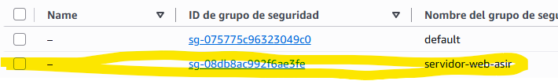
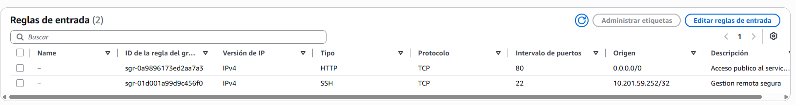
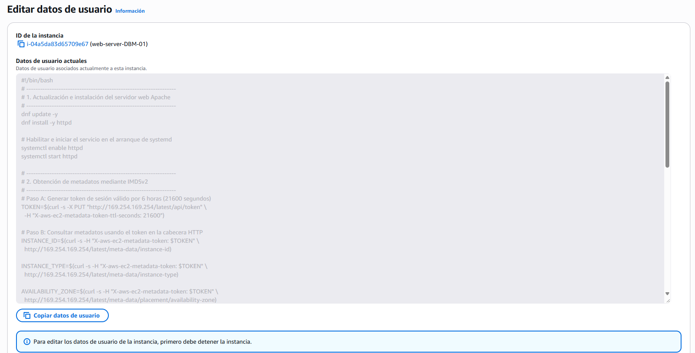
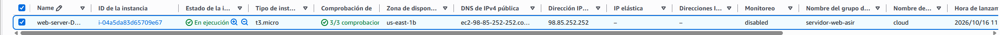
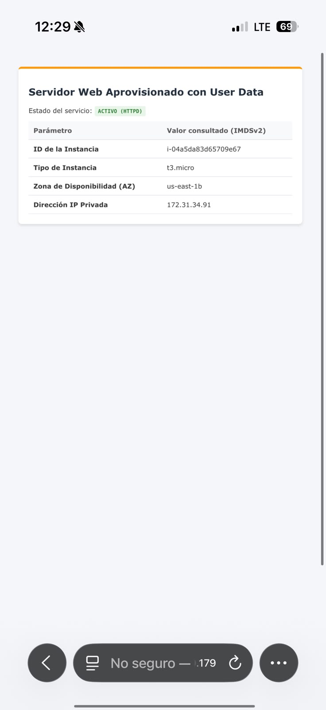
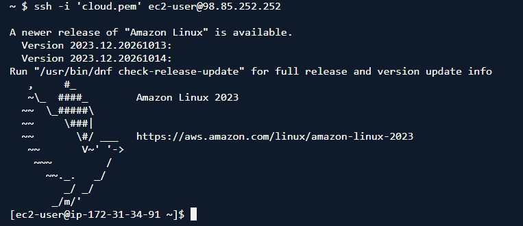
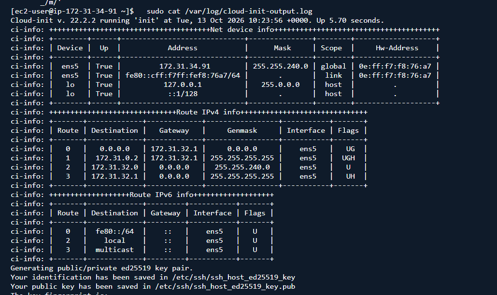
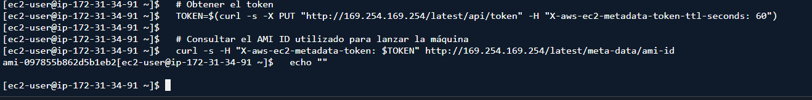

# Accedemos a la consola AWS y depuésen EC2-Seguridad y red- Grupos de seguridad
# Creamos el grupo de seguridad 

# Configuramos las reglas de entrada y dejamos por defecto las reglas de salida. 

# Una vez realizados esos pasos, procedemos al lanzamiento de la instancia.
# Configuramos la instancia poniendole el nombre, la arquitectura, el tipo de instancia, creamos el par de claves y configuramos la red añadiendo la ip del equipo anfitrión.
# Añadimos el scrip al final en User data. 

# Una vez realizada toda la configuración, lanzamos la instancia. 

# Cuando tenemos la instancia lanzada, ponemos la ip que hemos añadido en el navegador para comprobar que funciona. 

# Comprobado que funciona en el navegador, para comprobar el funcionamiento de cloud-init y como se procesa el script, hacemos los siguientes pasos en la terminal. 

[Volver al inicio](../index.md)