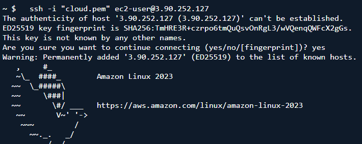
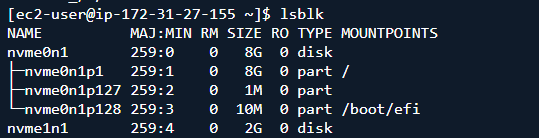
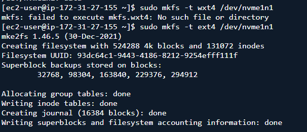
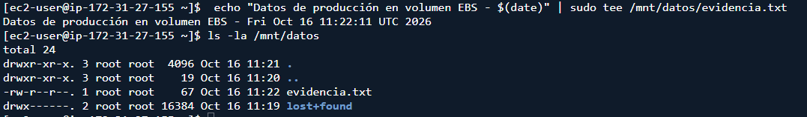
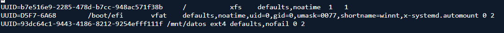
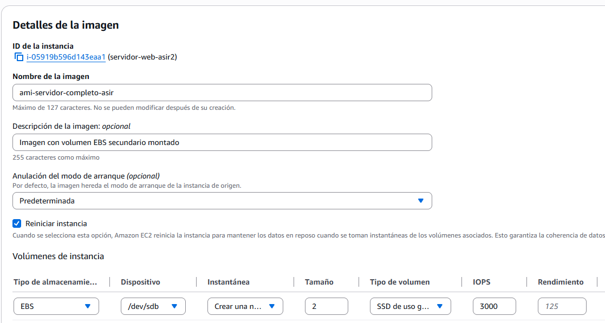
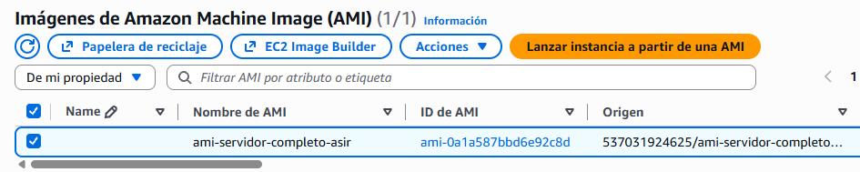
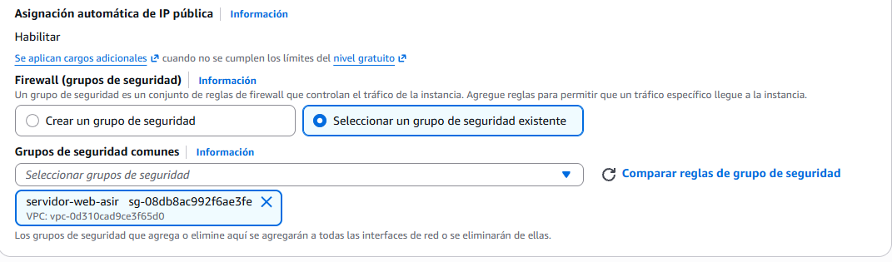
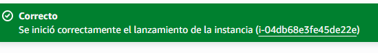
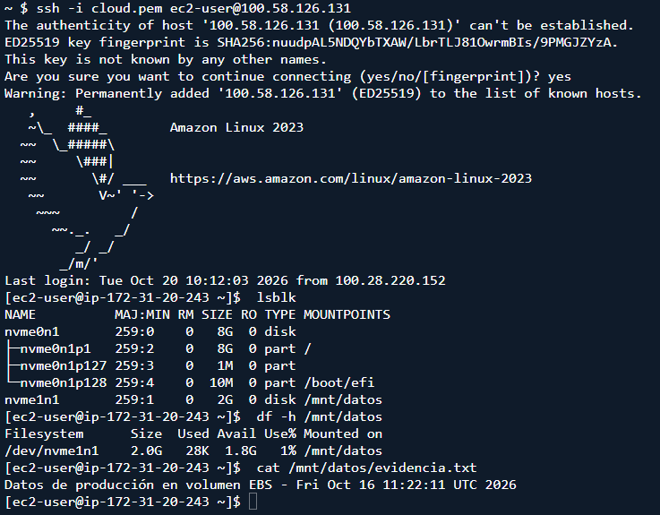

1. Verificación de la zona y lanzamiento de la maquina base.
    Creamos la nueva instancia.
2. Creación y conexión del volumen EBS.
    Creamos el volumen, poniendole el tamaño, la misma zona que la instancia y el nombre.
3. Configuración del almacenamiento en el sistema operativo.
    -   Nos conectamos a la maquina por ssh
        
    -   Hacemos un lsblk.
        
    -   Formateamos el disco con mkfs 
        
    -   Creamos un directorio como punto de montaje y el archivo de persistencia de datos.
        
4.  Automatización del montaje en /etc/fstab mediante UUID
    -   Obtenemos nuestro UUID del disco con sudo blkid /dev/nvme1n1, copiamos el UUID y lo copiamos de la manera que se ve en la imagen en /etc/fstab
        
5.  Creacion de la AMI.
    -   En la sección de la consola EC2, seleccionamos la instancia y en Actions creamos la imagen con los siguientes datos:
        
6.  Lanzamiento y verificación de la instacia clonada.
    -   Cuando el estado de la AMI es Available, lanzamos la instancia desde la AMI.
        
    -   Cumplimentamos todos los datos de la nueva instancia, el nombre, tipo, par de claves, configuración de la red (seleccionando el Security Group que tenemos creado) y el almacenamiento.
        
    -   Una vez realizados los pasos, pulsamos en Lanzar instancia. 
    -   Por último, una vez vemos que la instancia se ha lanzado correctamente, nos conectamos por shh a la máquina con la nueva ip.
        
        
        [Volver al inicio](../index.md)