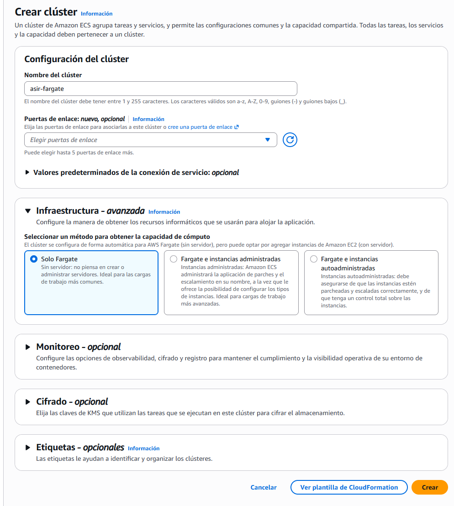
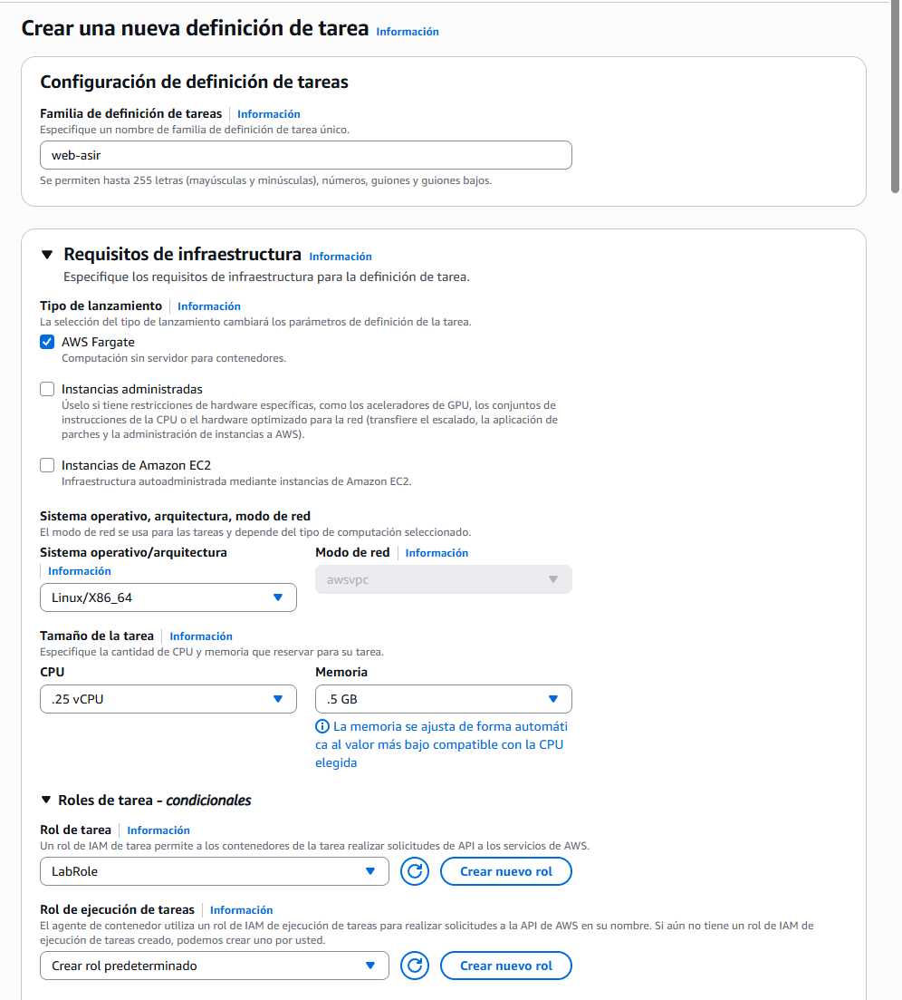
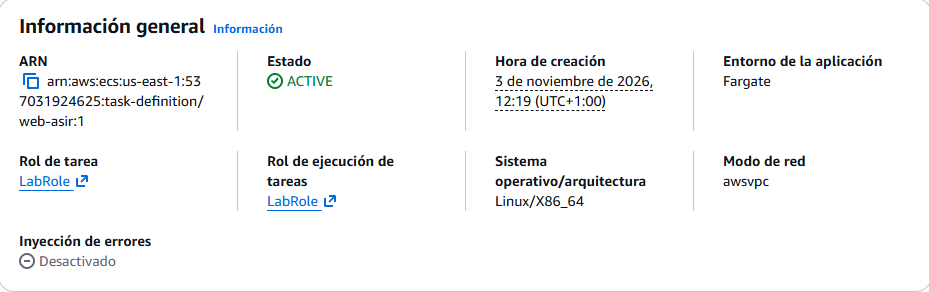
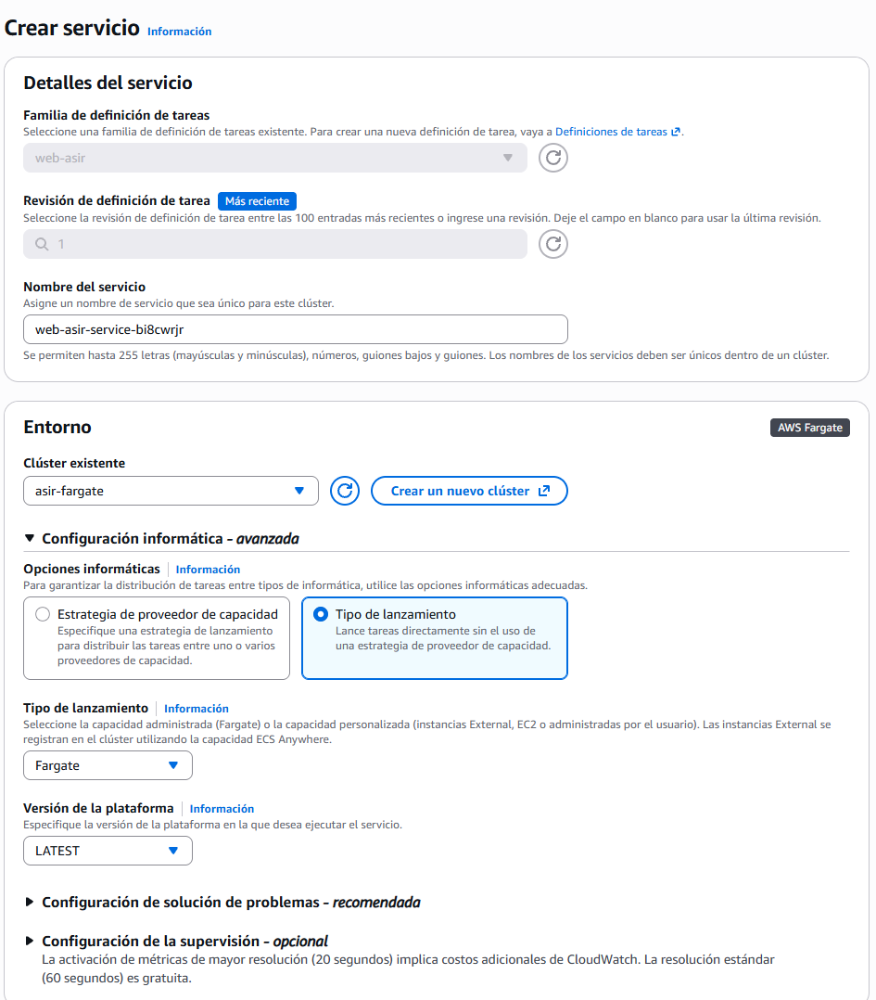
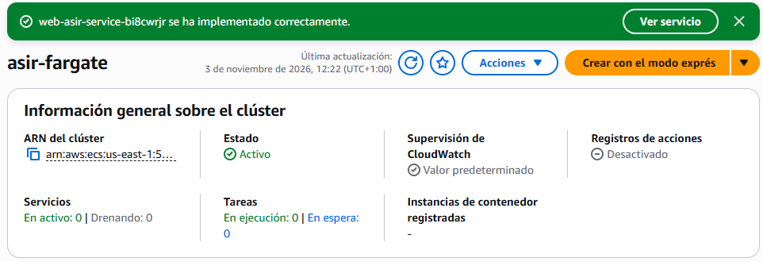
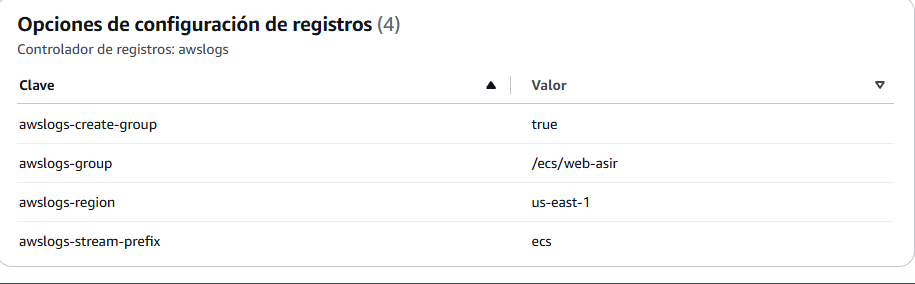
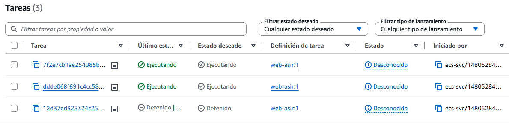
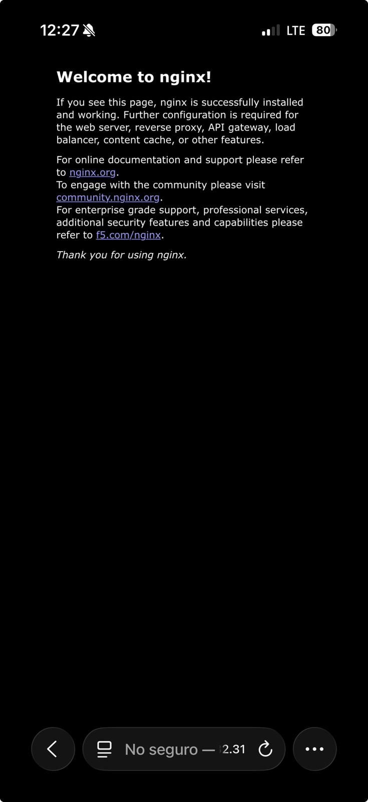

## Paso 1: Creación del clúster ECS con AWS Fargate
Creamos el ECS y el cluster.
    
## Paso 2: Creación de la Definición de Tarea (Task Definition)
Creamos la definición de la tarea.
    
    
## Paso 3: Despliegue del Servicio ECS
Para desplegar el servicio, configuramos todo lo necesario en enviroment, deployment, networking y en load balancing.
    
    
## Paso 4: Verificación y pruebas de acceso
Una vez realizado todo el proceso, hacemos la verificación y puebas de acceso entrando al cluster y seleccionando el servicio.
    
    
En el navegador, con http:// y la ip pública, comprobamos que todo funciona correctamente.
    

[Volver al inicio](../index.md)