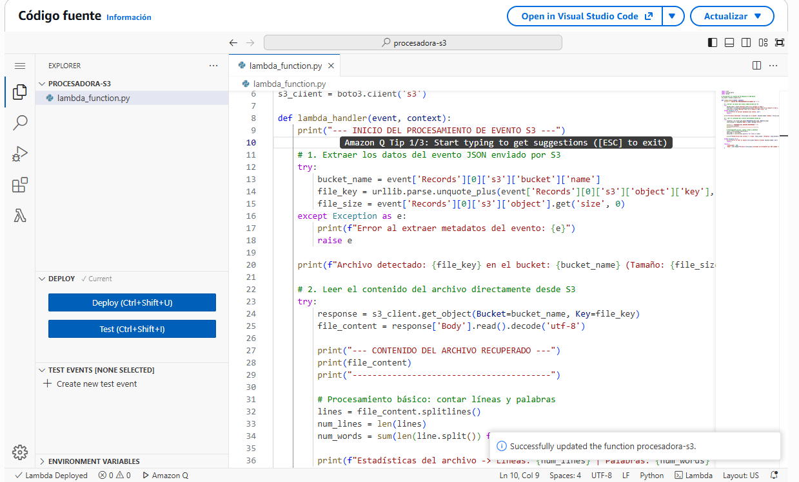
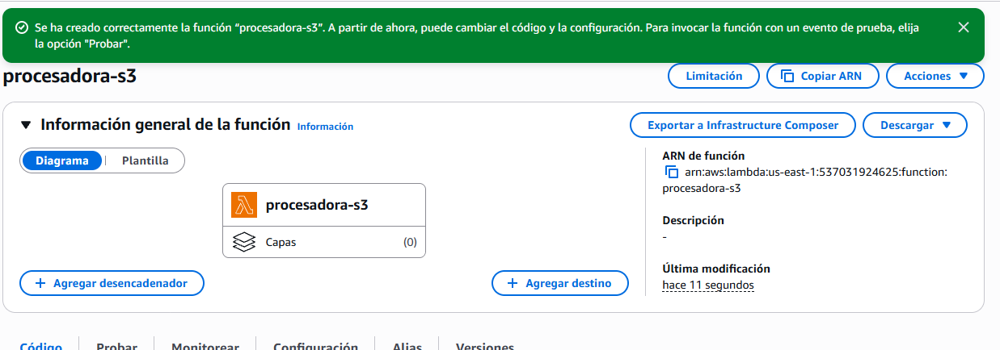
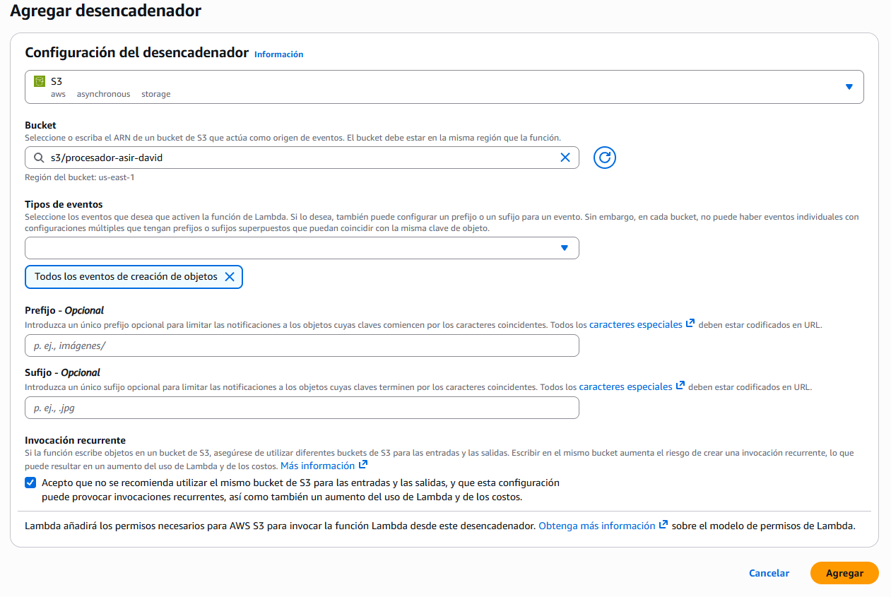
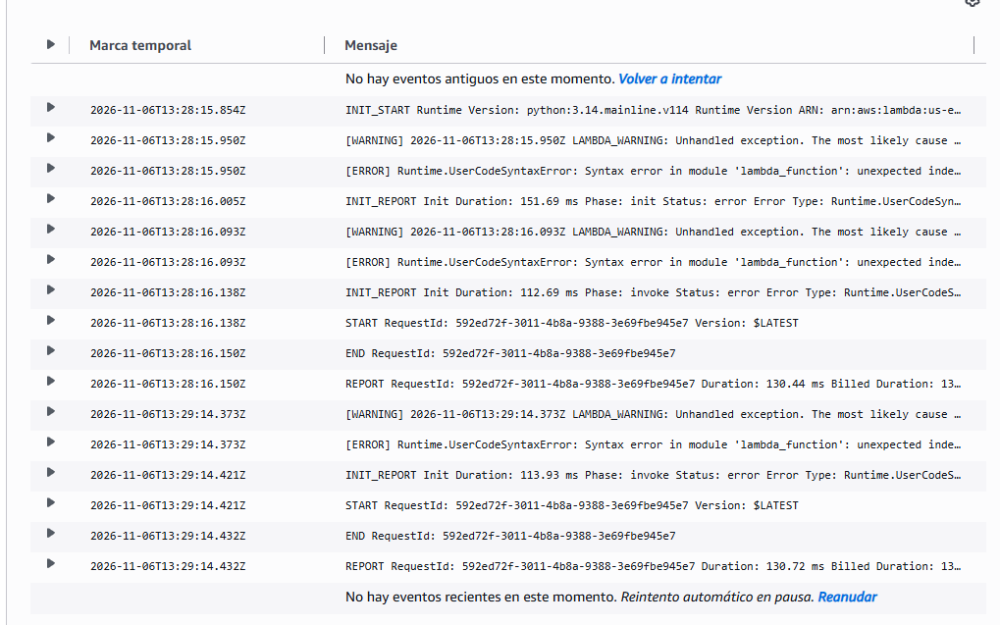

# Captura 1: consola de S3 mostrando el bucket creado y el archivo de texto de prueba subido correctamente
    
# Captura 2: diseñador de la función Lambda mostrando el disparador (Trigger) de S3 correctamente enlazado.
    
# Captura 3: fragmento del código Python implementado en el editor de Lambda con el uso de la librería boto3.
    
# Captura 4: consola de Amazon CloudWatch Logs mostrando la ejecución correcta de la función y la impresión del contenido del archivo de texto.
    

[Volver al inicio](../index.md)